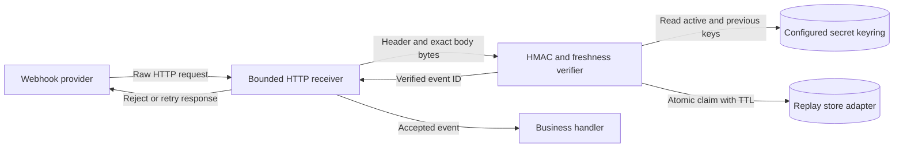
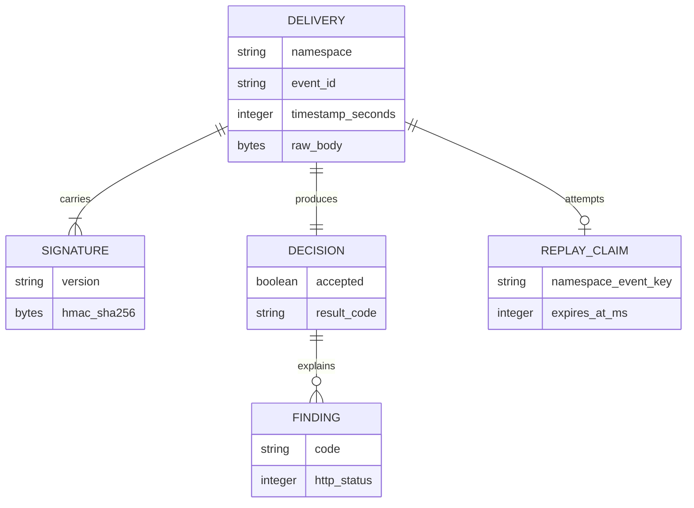
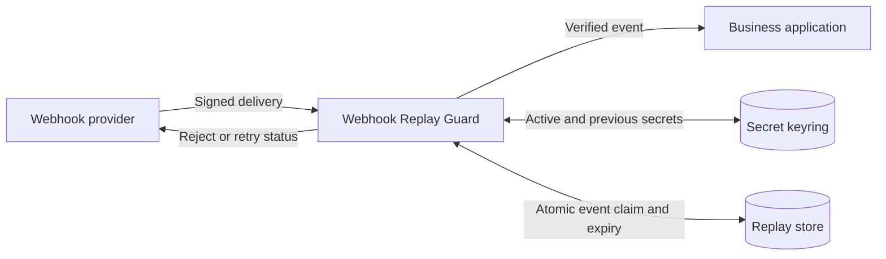
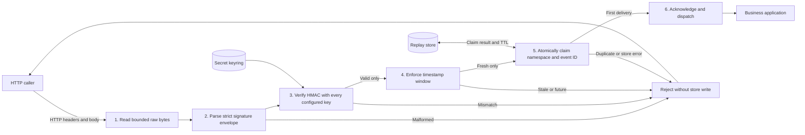
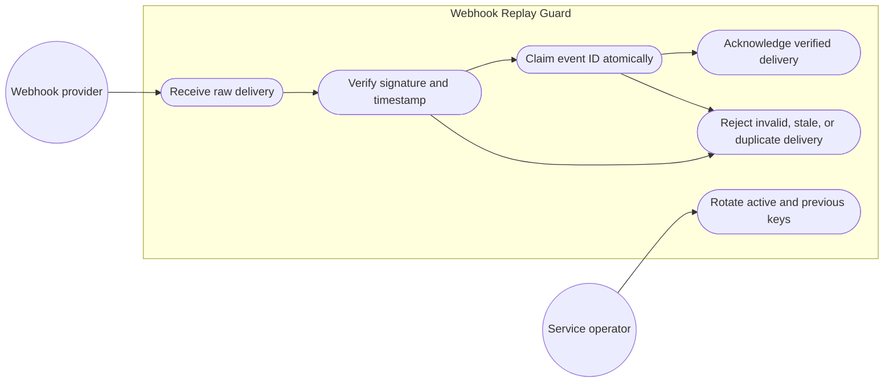
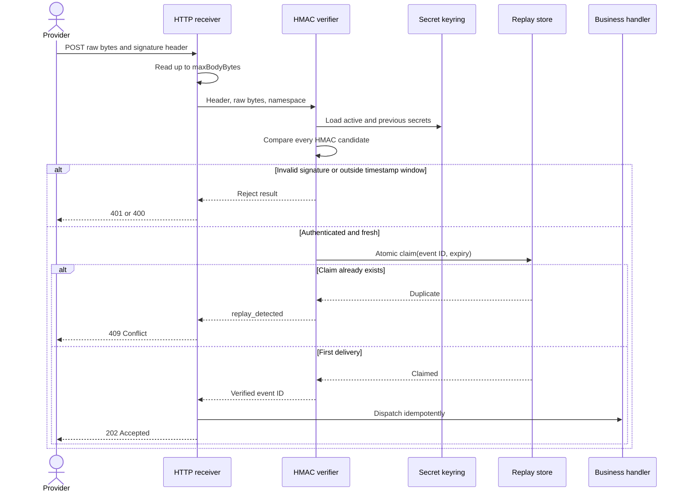

# Webhook Replay Guard

A dependency-free Node.js 20+ verifier for signed webhook deliveries. It combines HMAC-SHA-256 verification over exact request bytes, timestamp-window enforcement, key-rotation support, and an atomic replay-store contract. A small HTTP example demonstrates bounded body reads and fail-closed responses.

## The Problem

A valid HMAC alone does not stop a captured webhook from being replayed. Re-serializing JSON before verification can also change the signed bytes, and naive key rotation often creates an unsafe verification gap or leaks which key matched through early-exit comparisons. Teams need a narrow, auditable verification boundary that checks the original body, authenticates a stable delivery ID, enforces freshness, and atomically claims that ID before acknowledging the event.

## Architecture

The verifier parses a strict signature envelope (`t`, `id`, and one or more `v1` values), checks every configured key/signature pair using Node's constant-time comparison primitive, enforces the timestamp window, and only then claims `namespace:eventId` in the supplied replay store. This ordering avoids filling the replay store with unauthenticated IDs. A store error fails closed. The built-in `InMemoryReplayStore` is atomic only inside one Node.js process; production deployments with multiple instances must provide a shared store whose `claim` operation uses an atomic insert-if-absent with expiry.

The HMAC message is the UTF-8 prefix `${timestamp}.${eventId}.` followed by the exact raw body bytes. The verifier never parses or re-serializes JSON. Key rotation is supported by accepting a bounded set of active and previous secrets, and by allowing multiple `v1` signatures in one header during overlap.

### System Architecture Diagram



### Entity Relationship Diagram

This is the logical data model. The example stores replay claims in process memory; it does not require a relational database.



### Data Flow Diagram, Level 0



### Data Flow Diagram, Level 1



### Use Case Diagram



### Sequence Diagram



## Tech Stack

- **Node.js 20+** and ECMAScript modules
- **Built-in `node:crypto`** for HMAC-SHA-256 and `timingSafeEqual`
- **Built-in `node:http`** for the bounded example receiver
- **Built-in `node:test`** for unit and HTTP integration tests
- **No runtime or development dependencies**

## Local Setup

```bash
git clone https://github.com/kholipha-ahmmad-al-amin/webhook-replay-guard.git
cd webhook-replay-guard
npm test
```

To create a local random secret, run:

```bash
node -p "require('node:crypto').randomBytes(32).toString('hex')"
```

Set that value as `WEBHOOK_SECRET`. PowerShell:

```powershell
$env:WEBHOOK_SECRET = '<paste the generated value>'
$env:PORT = '3000'
npm run start:example
```

Bash:

```bash
export WEBHOOK_SECRET='<paste the generated value>'
export PORT=3000
npm run start:example
```

In a second terminal with the same secret configured, send a signed sample:

```bash
npm run send:sample
```

The receiver binds to `127.0.0.1` and accepts `POST /webhooks`. It returns `202` for a valid first delivery, `409` for a replay, `413` for an oversized body, and a fail-closed error for invalid signatures or unavailable replay storage.

## Library Usage

```js
import { createSignatureHeader, verifyWebhook } from 'webhook-replay-guard';
import { InMemoryReplayStore } from 'webhook-replay-guard/memory-replay-store';

const rawBody = Buffer.from(await request.arrayBuffer());
const result = await verifyWebhook({
  header: request.headers.get('x-webhook-signature'),
  rawBody,
  secrets: [process.env.WEBHOOK_SECRET, process.env.WEBHOOK_PREVIOUS_SECRET].filter(Boolean),
  replayStore: new InMemoryReplayStore(),
  namespace: 'billing-provider',
});

if (!result.ok) {
  // Do not process the payload. Use result.code for safe metrics, not secret/body logging.
  throw new Error(`Webhook rejected: ${result.code}`);
}

// Only now parse JSON and invoke an idempotent business operation.
const event = JSON.parse(rawBody.toString('utf8'));
```

`createSignatureHeader` exists for provider simulations and tests. Do not use it to generate production webhook secrets or to sign untrusted data.

## Replay Store Contract

Implement `claim(key, expiresAtMs)` so exactly one concurrent caller receives `true`; return `false` for an existing unexpired claim. The built-in in-memory adapter is intended for development or a single process only. It loses claims on restart and is not shared between replicas. For a distributed service, use an atomic insert-if-absent operation with a TTL in a shared store, scope keys by tenant/provider, monitor capacity, and keep failure behavior fail-closed. Do not replace the atomic claim with a separate read followed by write.

## Security Boundaries and Limitations

- Use the provider's exact raw request bytes. Framework JSON parsers must not run first.
- Keep secrets in a secret manager or environment injection, rotate by temporarily configuring current and previous keys, and never log keys, signatures, or full payloads.
- `eventId` is signed and namespace-scoped; the upstream provider must supply a stable unique delivery ID.
- The receiver example is a local demonstration, not a complete public-facing service. Add TLS termination, authentication controls, rate limiting, observability, provider-specific header normalization, and a shared replay store before production exposure.
- The HTTP example bounds retained body memory and request/header time, but deployment-level request limits and network controls remain necessary.
- The verifier accepts HMAC-SHA-256 only. It intentionally rejects unknown envelope fields and caps keys, signatures, header length, body size, and timestamp tolerance.

## Verification

```bash
npm test
```

The suite covers exact-byte signing, tampering, ID binding, key rotation, stale/future timestamps, replay detection, store failure, body limits, secret strength, and HTTP receiver behavior.

## License

MIT. See [LICENSE](LICENSE).

Developed by Kholipha Ahmmad Al-Amin
Founder and CEO, EquiSaaS BD | Principal Consultant, AR IT Consultancy
Expertise: Full Stack Enterprise Architecture & AI Engineering
GitHub: https://github.com/kholipha-ahmmad-al-amin
LinkedIn: https://www.linkedin.com/in/kholipha-ahmmad-al-amin
Portfolio: https://kholipha-ahmmad-al-amin.equisaas-bd.com
Email: kholifaahmadalamin@gmail.com